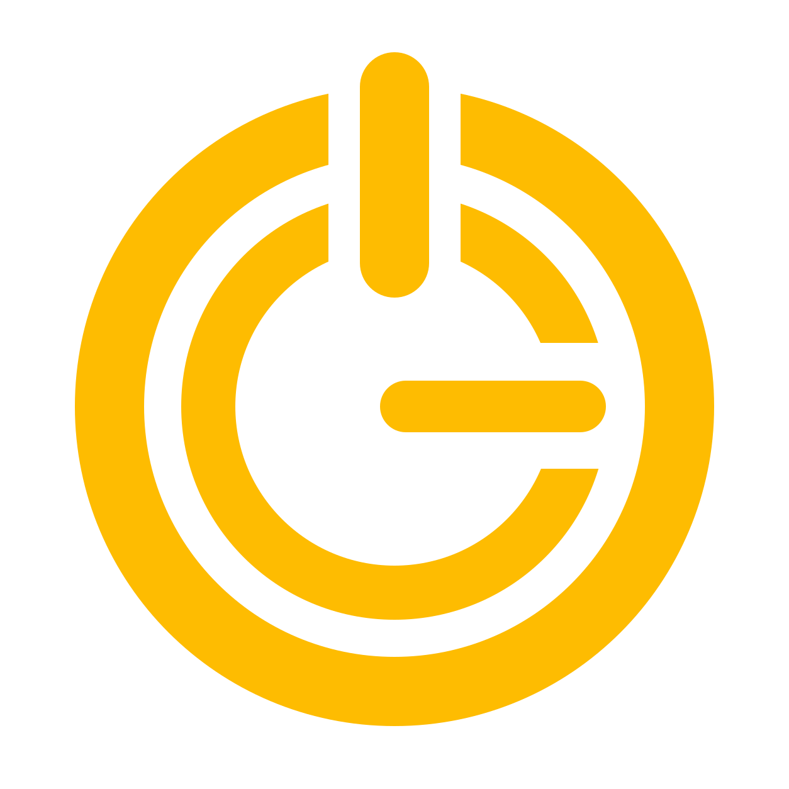

  

<h1 align="center">OCGSim</h1>

Game profiles, applications and OCG devices — managed together on Windows.

<a href="https://github.com/OmarLarbi/OneClickGO/releases">Download / Descargar</a> · <a href="LICENSE.en.txt">English license</a> · <a href="LICENSE.es.txt">Licencia en español</a>

## English

**OCGSim is the new name of OneClick&GO.** This remains its official distribution repository. The repository address stays unchanged, and earlier releases and license documents may use the previous name.

OCGSim brings together game profiles, associated applications, audio and OpenXR settings, and compatible OCG hardware. It also provides firmware installation and update tools for supported OCG devices.

This repository contains Windows installers, release notes and license documents. The application's source code is not published here.

### Downloads

Download the installer from [Releases](https://github.com/OmarLarbi/OneClickGO/releases) and read the notes for that version. Each release includes `SHA256SUMS.txt` to verify the downloaded installer's integrity.

### License and donations

Copyright © 2026 Omar Larbi Gutierrez.

OCGSim is proprietary software, free for personal, private and non-commercial use. Business, professional or commercial use requires prior, express written permission from the rights holder. Redistribution, including free redistribution, also requires that permission. You may share links to the official releases.

Read the [English license](LICENSE.en.txt) before downloading or installing. The [Spanish license](LICENSE.es.txt) is the original text; the English document is its translation. This presentation does not amend those license documents.

Donations are voluntary, provide no additional features or benefits, and do not grant commercial-use or redistribution rights. The existing [donor data](donantes.json) and [project goals](objetivos-donaciones.json) remain available.

---

## Español

**OCGSim es el nuevo nombre de OneClick&GO.** Este sigue siendo su repositorio oficial de distribución. Su dirección no cambia; las versiones anteriores y los documentos de licencia pueden conservar el nombre anterior.

OCGSim reúne perfiles de juego, aplicaciones asociadas, ajustes de audio y OpenXR y hardware OCG compatible. También ofrece herramientas de instalación y actualización de firmware para los dispositivos OCG admitidos.

Este repositorio contiene instaladores para Windows, notas de versiones y licencias. El código fuente de la aplicación no se publica aquí.

### Descargas

Descarga el instalador desde [Releases](https://github.com/OmarLarbi/OneClickGO/releases) y consulta las notas de esa versión. Cada publicación incluye `SHA256SUMS.txt` para comprobar la integridad del instalador descargado.

### Licencia y donaciones

Copyright © 2026 Omar Larbi Gutierrez.

OCGSim es software propietario gratuito para uso personal, privado y no comercial. El uso empresarial, profesional o comercial requiere autorización previa, expresa y escrita del titular. La redistribución, incluso gratuita, también requiere esa autorización. Puedes compartir enlaces a las publicaciones oficiales.

Consulta la [licencia original en español](LICENSE.es.txt) antes de descargar o instalar. También está disponible su [traducción al inglés](LICENSE.en.txt). Esta presentación no modifica esos documentos de licencia.

Las donaciones son voluntarias, no ofrecen funciones ni beneficios adicionales y no conceden permisos comerciales ni de redistribución. Se mantienen disponibles los [datos de donantes](donantes.json) y los [objetivos del proyecto](objetivos-donaciones.json).
