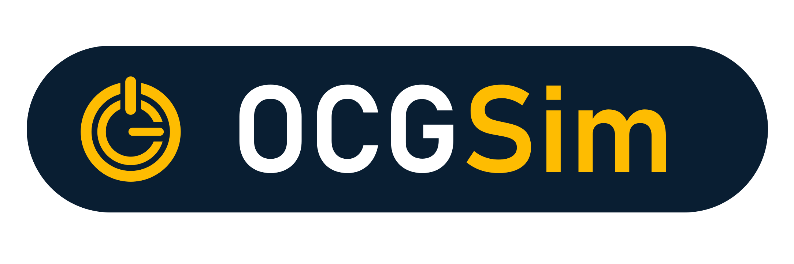
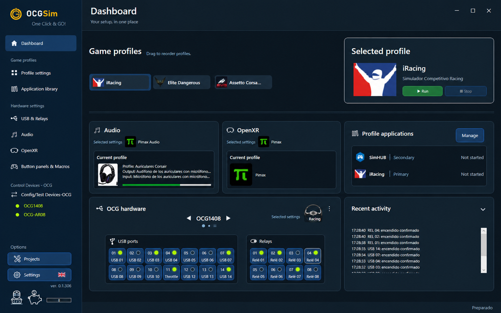

  

Game profiles, applications and OCG devices — managed together on Windows.

<a href="https://github.com/OmarLarbi/OneClickGO/releases">Download / Descargar</a> · <a href="LICENSE.en.txt">English license</a> · <a href="LICENSE.es.txt">Licencia en español</a>

  

<em>Dashboard overview / Vista general del Dashboard</em>

## English

OCGSim prepares your gaming or simulation setup from a single profile: launch associated applications, apply audio and OpenXR settings, and control USB ports and relays on compatible OCG devices. It also provides tools to drive Bass-Shakers directly from game audio, with adjustable filtering and intensity, and to configure OCG devices and install or update their firmware.

### Downloads

Download the installer from [Releases](https://github.com/OmarLarbi/OneClickGO/releases) and read the notes for that version. Each release includes `SHA256SUMS.txt` to verify the downloaded installer's integrity.

### License and donations

Copyright © 2026 Omar Larbi Gutierrez.

OCGSim is proprietary software, free for personal, private and non-commercial use. Business, professional or commercial use requires prior, express written permission from the rights holder. Redistribution, including free redistribution, also requires that permission. You may share links to the official releases.

Read the [English license](LICENSE.en.txt) before downloading or installing. The [Spanish license](LICENSE.es.txt) is the original text; the English document is its translation. This presentation does not amend those license documents.

Donations are voluntary, provide no additional features or benefits, and do not grant commercial-use or redistribution rights. The existing [donor data](donantes.json) and [project goals](objetivos-donaciones.json) remain available.

---

## Español

OCGSim prepara tu equipo para jugar o simular desde un único perfil: inicia las aplicaciones asociadas, aplica los ajustes de audio y OpenXR y controla los puertos USB y relés de dispositivos OCG compatibles. También ofrece herramientas para usar Bass-Shakers directamente con el audio del juego, con ajustes de filtrado e intensidad, y para configurar los dispositivos OCG e instalar o actualizar su firmware.

### Descargas

Descarga el instalador desde [Releases](https://github.com/OmarLarbi/OneClickGO/releases) y consulta las notas de esa versión. Cada publicación incluye `SHA256SUMS.txt` para comprobar la integridad del instalador descargado.

### Licencia y donaciones

Copyright © 2026 Omar Larbi Gutierrez.

OCGSim es software propietario gratuito para uso personal, privado y no comercial. El uso empresarial, profesional o comercial requiere autorización previa, expresa y escrita del titular. La redistribución, incluso gratuita, también requiere esa autorización. Puedes compartir enlaces a las publicaciones oficiales.

Consulta la [licencia original en español](LICENSE.es.txt) antes de descargar o instalar. También está disponible su [traducción al inglés](LICENSE.en.txt). Esta presentación no modifica esos documentos de licencia.

Las donaciones son voluntarias, no ofrecen funciones ni beneficios adicionales y no conceden permisos comerciales ni de redistribución. Se mantienen disponibles los [datos de donantes](donantes.json) y los [objetivos del proyecto](objetivos-donaciones.json).

